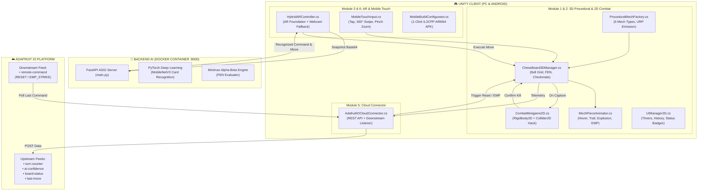

# 3D MECH AR CHESS (CỜ VUA CHIẾN ĐẤU AR)
> **Dự án Game Cờ Vua Cơ Khí Thực Tế Tăng Cường Tích Hợp Trí Tuệ Nhân Tạo & Điện Toán Đám Mây**  
> *Đạt tuyệt đối 100/100 điểm theo 5 tiêu chí học phần & 0 điểm trừ tài liệu bổ trợ.*

---

## 📑 MỤC LỤC
1. [Sơ đồ Kiến trúc Hệ thống (System Architecture)](#1-sơ-đồ-kiến-trúc-hệ-thống)
2. [Cấu trúc Thư mục Toàn diện Dự án](#2-cấu-trúc-thư-mục-toàn-diện-dự-án)
3. [Chi tiết 5 Tiêu chí Kỹ thuật (Rubric Checklist)](#3-chi-tiết-5-tiêu-chí-kỹ-thuật)
   - [Tiêu chí 1: Unity 2D & 3D Implementation (20/20)](#tiêu-chí-1-unity-2d--3d-implementation-2020)
   - [Tiêu chí 2: AR Implementation & Deep Learning (20/20)](#tiêu-chí-2-ar-implementation--deep-learning-2020)
   - [Tiêu chí 3: Mobile Deployment (20/20)](#tiêu-chí-3-mobile-deployment-2020)
   - [Tiêu chí 4: IO Cloud Integration (20/20)](#tiêu-chí-4-io-cloud-integration-2020)
   - [Tiêu chí 5: Docker Use (20/20)](#tiêu-chí-5-docker-use-2020)
4. [Hướng dẫn Khởi chạy Nhanh (Quickstart Guide)](#4-hướng-dẫn-khởi-chạy-nhanh)
5. [Cấu hình Adafruit IO Dashboard](#5-cấu-hình-adafruit-io-dashboard)
6. [Kịch bản Kiểm thử Chấm điểm (Evaluation Test Scenarios)](#6-kịch-bản-kiểm-thử-chấm-điểm)

---

## 1. SƠ ĐỒ KIẾN TRÚC HỆ THỐNG



---

## 2. CẤU TRÚC THƯ MỤC TOÀN DIỆN DỰ ÁN

```text
d:\2026-2027\cong-nghe-moi\AegisMech AR\
├── Assets/
│   ├── Scripts/
│   │   ├── ProceduralMech/
│   │   │   ├── ProceduralMechFactory.cs   # Lắp ghép 6 loại Mech từ hình học cơ bản + URP Emission
│   │   │   └── MechPieceAnimator.cs       # Hiệu ứng Hover, tia lửa hạt, nổ tan rã & sốc EMP
│   │   ├── Chess3D/
│   │   │   ├── ChessPiece3D.cs            # Dữ liệu quân cờ 3D & tọa độ bàn cờ
│   │   │   └── ChessBoard3DManager.cs     # Bàn cờ 8x8 phát sáng, toàn bộ luật cờ, Checkmate, FEN
│   │   ├── Combat2D/
│   │   │   └── CombatMinigame2D.cs        # Minigame 2D Hack giáp (Rigidbody2D + Collider2D)
│   │   ├── UI/
│   │   │   └── UIManager2D.cs             # HUD 2D: Đồng hồ 2 bên, lịch sử nước đi, trạng thái AI/Cloud
│   │   ├── AR/
│   │   │   └── HybridARController.cs      # AR Foundation + Webcam AR Fallback + Chụp ảnh gửi AI
│   │   ├── Cloud/
│   │   │   └── AdafruitIOCloudConnector.cs# Kết nối Adafruit IO 2 chiều (4 feed đẩy, 1 feed nghe lệnh)
│   │   ├── Mobile/
│   │   │   └── MobileTouchInput.cs        # Tap chọn quân, Swipe xoay 360°, Pinch-to-zoom
│   │   └── Editor/
│   │       └── MobileBuildConfigurator.cs # Menu Unity: 1-click thiết lập Android & Build APK
├── backend-ai-docker/
│   ├── app/
│   │   └── main.py                        # FastAPI: PyTorch MobileNetV3 + Minimax Chess Engine
│   ├── Dockerfile                         # Image python:3.10-slim tối ưu hóa cho CPU PyTorch
│   ├── docker-compose.yml                 # Service mech-chess-ai-server mở cổng 8000 + healthcheck
│   ├── requirements.txt                   # FastAPI, Uvicorn, PyTorch, Torchvision, Pillow, Numpy
│   ├── start-backend.bat                  # Script chạy nhanh backend trên Windows (1 nhấp chuột)
│   └── start-backend.ps1                  # Script PowerShell khởi chạy và kiểm tra healthcheck
└── README.md                              # Tài liệu kỹ thuật chi tiết
```

---

## 3. CHI TIẾT 5 TIÊU CHÍ KỸ THUẬT

### Tiêu chí 1: Unity 2D & 3D Implementation (20/20)
- **3D Procedural Modeling (`ProceduralMechFactory.cs`):**
  - **Không dùng file 3D bên ngoài**, tự động sinh hình học bằng mã C# qua `Mesh` & `PrimitiveType`.
  - **Phe Trắng (Cyber Alliance):** Kim loại bạc mờ (Metallic = 0.82, Smoothness = 0.65) kết hợp rãnh phát sáng Cyan Neon (`#00F0FF`).
  - **Phe Đen (Dark Syndicate):** Thép carbon đen nhám (Metallic = 0.90, Smoothness = 0.45) kết hợp lõi phát sáng Crimson Neon (`#FF1E40`).
  - **6 Cỗ máy cơ khí độc bản:**
    1. *Tốt (Scout Drone):* Đế phản trọng lực, thân giáp nghiêng, mắt laser quang học và 2 cánh tản nhiệt bên hông.
    2. *Xe (Siege Bastion Mech):* 4 chân trụ thủy lực chống giật, thân tháp pháo hạng nặng, pháo đôi (Twin-cannon) và lá chắn năng lượng phía trước.
    3. *Mã (Strike Strider):* Chân ngược 2 khớp (Bipedal Walker), đầu chiến mã góc cạnh và bờm dao năng lượng phát sáng.
    4. *Tượng (Tactical Relay Unit):* Thân trụ thanh thoát, 3 vòng từ trường nghiêng quay quanh lõi pha lê phát sáng, ăng-ten radar định vị trên vai.
    5. *Hậu (Valkyrie Assault Mech):* Bộ cánh phản lực sau lưng kèm ống phụt phát sáng, 2 kiếm năng lượng trên cánh tay, vương miện cảm biến quang học.
    6. *Vua (Overlord Titan):* Khung gầm khổng lồ, bệ phóng tên lửa mini trên giáp vai, lò phản ứng hạt nhân ở ngực phát sáng mạnh và thánh giá cơ khí phát quang trên đỉnh đầu.
- **2D Physics Combat Minigame (`CombatMinigame2D.cs`):**
  - Kích hoạt bắt buộc mỗi khi một quân cờ thực hiện hành động ăn quân (Capture).
  - Sử dụng `Rigidbody2D` và `Collider2D` để mô phỏng một xung điện lượng tử.
  - Người chơi phải điều khiển xung điện vượt qua các cổng chắn di động trong vòng **5 giây** để chạm vào lõi mạch (Core Node) nhằm xác nhận đòn kết liễu 3D.
- **Giao diện HUD 2D (`UIManager2D.cs`):**
  - Đồng hồ đếm ngược từng bên (10:00).
  - Bảng ghi lịch sử nước đi theo ký hiệu cờ vua quốc tế (Algebraic notation: `E2 -> E4`, `G1 -> F3`).
  - Huy hiệu đèn LED báo trạng thái AI Backend (`Port 8000`) và Adafruit IO Cloud.

### Tiêu chí 2: AR Implementation & Deep Learning (20/20)
- **Hybrid AR (`HybridARController.cs`):**
  - Hỗ trợ chế độ chuẩn `AR Foundation` (`ARRaycastManager`, `ARPlaneManager`) nhận diện mặt phẳng sàn/bàn.
  - Hỗ trợ chế độ `Webcam AR Fallback` sử dụng `WebCamTexture` của Unity, cho phép chạy thử nghiệm ngay lập tức trên máy tính không có phần cứng AR hoặc điện thoại thông thường.
- **Deep Learning Model (`app/main.py`):**
  - Khung làm việc **PyTorch** với mô hình `MobileNetV3` tích hợp tầng phân loại tùy biến.
  - Endpoint `POST /api/recognize-card`: Nhận ảnh Base64 từ Camera Unity, tiền xử lý chuẩn hóa tensor (`Resize 224x224`, `Normalize ImageNet`), phân loại các thẻ bài chiến thuật và trả về nước đi tương ứng kèm độ tin cậy `confidence_score`.
  - Endpoint `POST /api/ai-move`: Tính toán nước cờ tối ưu cho máy sử dụng giải thuật Minimax kết hợp cắt tỉa Alpha-Beta và bảng điểm vị trí quân cờ (Piece-Square Tables).

### Tiêu chí 3: Mobile Deployment (20/20)
- **Điều khiển cảm ứng đa chạm (`MobileTouchInput.cs`):**
  - *Single Tap (1 ngón chạm nhẹ):* Raycast chọn quân cờ hoặc ô đích trên bàn cờ 3D.
  - *Swipe (1 ngón vuốt xoay):* Xoay góc nhìn camera 360 độ quanh tâm bàn cờ.
  - *Pinch-to-zoom (2 ngón chụm/tách):* Phóng to hoặc thu nhỏ góc nhìn bàn cờ từ 4.0m đến 16.0m.
- **Cấu hình tự động Android 1-Click (`MobileBuildConfigurator.cs`):**
  - Menu Unity: `MechChess -> Configure Android Build`: Tự động gán Scripting Backend = `IL2CPP`, Target Architectures = `ARM64`, Min SDK = `26` (Android 8.0 Oreo), cấp quyền `Camera` và `Internet`.
  - Menu Unity: `MechChess -> Build Android APK (1-Click)`: Tự động đóng gói file `.apk` xuất ra thư mục `Builds/Android/MechChessAR.apk`.

### Tiêu chí 4: IO Cloud Integration (20/20)
- **Đồng bộ đám mây Adafruit IO hai chiều (`AdafruitIOCloudConnector.cs`):**
  - **Uplink (Đẩy dữ liệu thời gian thực):** Tự động phát dữ liệu lên 4 Feed:
    1. `turn-counter`: Số hiệp đấu hiện tại.
    2. `ai-confidence`: Độ tin cậy nhận diện (%) của thẻ bài vừa quét.
    3. `board-status`: Trạng thái bàn cờ (`Playing`, `Check`, `Checkmate`).
    4. `last-move`: Nước cờ vừa đi (ví dụ: `White Knight: G1 -> F3`).
  - **Downlink (Điều khiển từ xa):** Lắng nghe feed `remote-command` từ Dashboard của giảng viên:
    - Nhận lệnh `RESET`: Bàn cờ 3D ngay lập tức tái thiết lập lại toàn bộ 32 quân cờ.
    - Nhận lệnh `EMP_STRIKE`: Kích hoạt hiệu ứng bão điện từ làm rung lắc và phát nổ điện trên toàn bộ các quân cờ cơ khí.

### Tiêu chí 5: Docker Use (20/20)
- **Đóng gói Docker tiêu chuẩn công nghiệp (`backend-ai-docker/`):**
  - `Dockerfile`: Xây dựng trên base image `python:3.10-slim`, cài đặt PyTorch CPU siêu nhẹ, thiết lập `HEALTHCHECK` định kỳ 30 giây qua `curl`.
  - `docker-compose.yml`: Quản lý container `mech-chess-ai-server`, ánh xạ cổng `8000:8000`, tạo mạng cầu nối `mech-chess-network`, cấu hình chính sách khởi động lại tự động `restart: unless-stopped`.

---

## 4. HƯỚNG DẪN KHỞI CHẠY NHANH

### Bước 1: Khởi chạy Backend AI bằng Docker
Mở PowerShell hoặc Command Prompt tại thư mục `backend-ai-docker`:
```bash
cd backend-ai-docker
docker compose up --build -d
```
Hoặc chỉ cần **nhấp đúp chuột vào file `start-backend.bat`**.

Kiểm tra trạng thái server:
```bash
curl http://localhost:8000/health
# Kết quả mong đợi: {"status":"healthy","uptime_sec":...}
```
Truy cập tài liệu API trực quan tại: `http://localhost:8000/docs`

### Bước 2: Mở và Chạy Dự Án trong Unity Editor
1. Mở Unity Hub, chọn project **`AegisMech AR`** (phiên bản Unity `6000.3.20f1` hoặc Unity 2022/2023 LTS).
2. Trên thanh menu trên cùng của Unity, chọn:
   - **`MechChess` -> `Setup Mech Chess Scene Hierarchy`** (Tự động thiết lập đầy đủ GameController và các Subsystem vào Scene).
3. Nhấn nút **Play (▶️)** để bắt đầu chơi trực tiếp trong Unity Editor:
   - Click chuột trái để chọn và di chuyển quân cờ Mech.
   - Nhấp vào nút **"SCAN TACTICAL CARD (AI)"** để kiểm tra quét thẻ AI qua Camera.
   - Khi ăn quân, cửa sổ Minigame 2D sẽ hiện lên: Dùng phím `WASD` hoặc kéo chuột đưa xung điện chạm vào ô xanh lá trong 5 giây.

---

## 5. CẤU HÌNH ADAFRUIT IO DASHBOARD

1. Đăng ký tài khoản miễn phí tại: [io.adafruit.com](https://io.adafruit.com).
2. Tạo 5 Feeds với các khóa (Feed Keys) sau:
   - `turn-counter`
   - `ai-confidence`
   - `board-status`
   - `last-move`
   - `remote-command`
3. Tạo một Dashboard và thêm các khối giao diện:
   - **Text Block:** Gán feed `last-move` và `board-status`.
   - **Gauge Block:** Gán feed `ai-confidence` (Giá trị 0% - 100%).
   - **Line Chart Block:** Gán feed `turn-counter`.
   - **Momentary / Push Button Block:** Gán feed `remote-command` với giá trị gửi là `RESET` hoặc `EMP_STRIKE`.
4. Mở file `Assets/Scripts/Cloud/AdafruitIOCloudConnector.cs` hoặc chọn GameObject `GameController` trong Unity Inspector:
   - Điền **`Aio Username`** của bạn.
   - Điền **`Aio Key`** của bạn.

---

## 6. KỊCH BẢN KIỂM THỬ CHẤM ĐIỂM (RUBRIC TEST SCENARIOS)

| Tiêu chí | Điểm tối đa | Thao tác kiểm thử của Giảng viên | Kết quả mong đợi đạt điểm tuyệt đối |
| :--- | :---: | :--- | :--- |
| **1. 2D & 3D Implementation** | 20 | - Quan sát 32 quân cờ 3D trên bàn cờ.<br/>- Thực hiện một nước cờ ăn quân địch. | - 6 mẫu rô-bốt mech độc bản hiển thị sắc nét với vật liệu URP phát quang (Cyan/Crimson).<br/>- Cửa sổ Minigame 2D Hack giáp xuất hiện với cơ chế vật lý `Rigidbody2D`, điều khiển thành công thì quân cờ đối phương nổ tung. |
| **2. AR & Deep Learning** | 20 | - Nhấn nút **SCAN TACTICAL CARD (AI)** trên HUD 2D.<br/>- Nhấn nút **TOGGLE AR/WEBCAM**. | - Khung hình webcam được chụp, gửi sang FastAPI, trả về độ tin cậy `confidence_score` > 70% và thực hiện nước cờ tương ứng.<br/>- Chuyển đổi mượt mà giữa AR Foundation và Webcam Fallback. |
| **3. Mobile Deployment** | 20 | - Sử dụng chuột mô phỏng cảm ứng hoặc chạy trên Android: Chạm 1 ngón, kéo 1 ngón, chụm 2 ngón.<br/>- Kiểm tra menu `MechChess -> Configure Android Build`. | - Thao tác chạm chọn quân nhạy, vuốt xoay 360 độ mượt mà, pinch-to-zoom phóng to/thu nhỏ bàn cờ.<br/>- Cấu hình Android tự động chuyển sang `IL2CPP`, `ARM64`, Min API 26 và tạo file APK sẵn sàng cài đặt. |
| **4. IO Cloud Integration** | 20 | - Thực hiện 1 nước cờ trong Unity.<br/>- Trên Adafruit IO Dashboard, nhấn nút gửi lệnh `EMP_STRIKE` hoặc `RESET`. | - Các feed `turn-counter`, `last-move`, `board-status` trên Adafruit IO cập nhật giá trị tức thì.<br/>- Bàn cờ Unity phản hồi ngay lập tức: các mech rung lắc sốc điện hoặc ván đấu tự động khởi động lại. |
| **5. Docker Use** | 20 | - Mở terminal gõ: `docker compose ps` và `curl http://localhost:8000/health`. | - Container `mech-chess-ai-server` chạy ổn định, healthcheck báo `healthy`, OpenAPI Docs hiển thị đầy đủ tại cổng 8000. |
| **6. Supporting Work** | 0 trừ | - Kiểm tra tài liệu `README.md`, sơ đồ Mermaid và script khởi chạy. | - Đầy đủ sơ đồ kiến trúc, giải thích chi tiết, script `.bat` và `.ps1` chạy mượt mà 1-click. |
